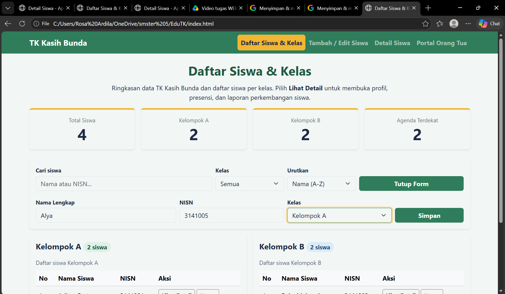
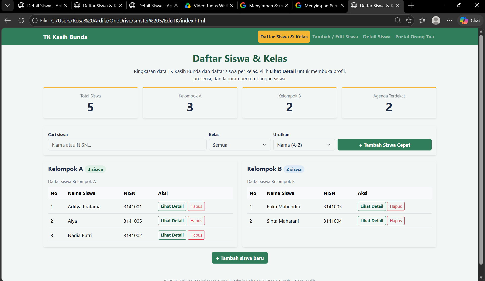
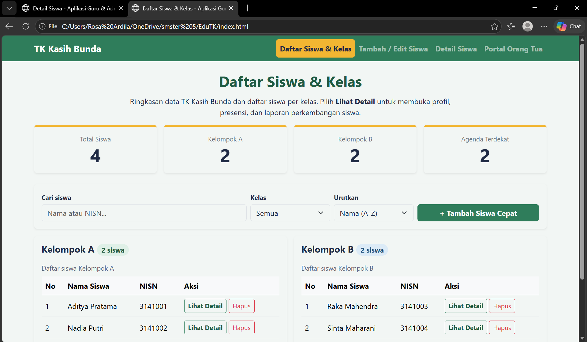
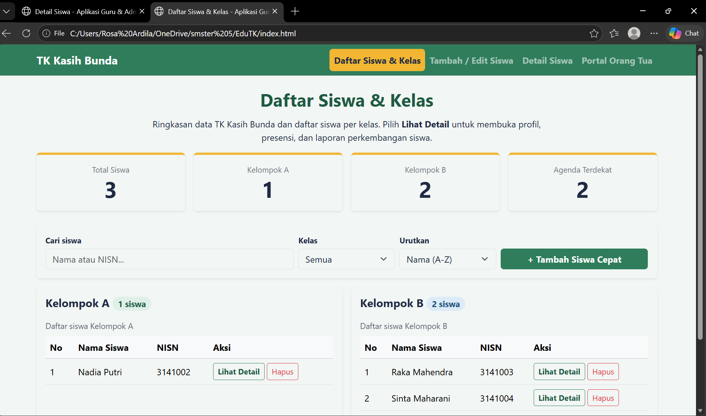
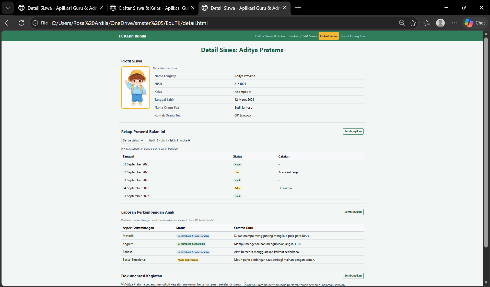
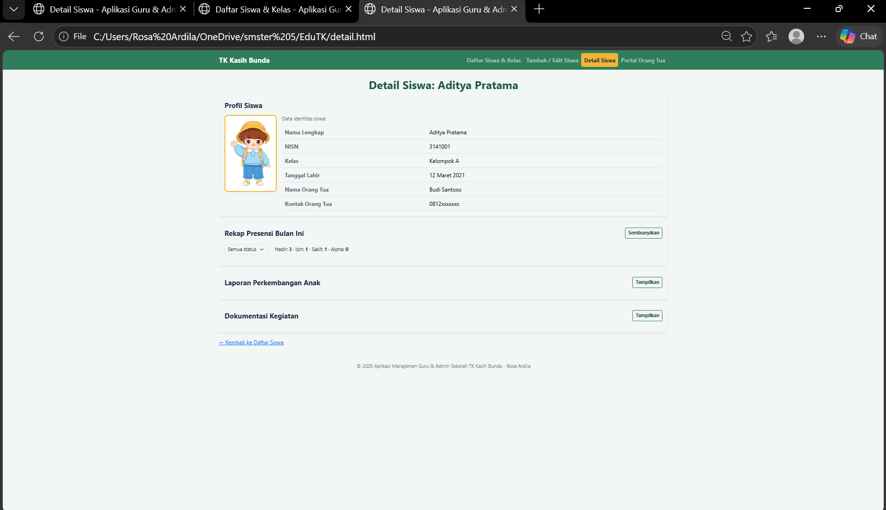

---

## Tugas 5: JavaScript & jQuery

Menambahkan interaktivitas sisi client pada halaman yang sudah ada (tanpa halaman baru). Data masih dummy (array of object di `script.js`), belum terhubung backend/database. jQuery 3.7.1 dimuat lewat CDN, lalu `script.js`.

### JavaScript murni
- **Data dummy:** `dataSiswa`, `dataPresensi`, `dataPerkembangan`, `dataPengumuman` (array of object).
- **Function pemroses data:** `hitungPerKelas()`, `filterSiswa()`, `urutkanSiswa()`, `hitungPresensi()`, `validasiSiswa()`.
- **Struktur kendali:** `for...of`, `forEach`, `if/else`, `switch` untuk me-render tabel dari array (tabel siswa, presensi, laporan perkembangan, pengumuman tidak lagi ditulis manual di HTML).

### jQuery
| Halaman | Interaksi |
|---|---|
| `index.html` | Cari siswa (nama/NISN), filter kelas, urutkan; tombol **Tambah Siswa Cepat** (`slideToggle` form); validasi lalu tambah siswa ke array; tombol **Hapus** (`fadeOut`) dengan konfirmasi; statistik dan badge jumlah siswa ikut berubah |
| `form.html` | Validasi saat submit (field kosong, NISN 7–10 digit, kontak); kolom catatan presensi muncul (`slideDown`) hanya jika status Izin/Sakit/Alpha dan wajib diisi; notifikasi `fadeIn/fadeOut` |
| `detail.html`, `portal-ortu.html` | Filter presensi per status + rekap jumlah; tombol **Sembunyikan/Tampilkan** tiap kartu (`slideToggle`) |
| `login-guru.html`, `login-ortu.html` | Validasi sederhana sebelum submit; login orang tua mengecek NISN terdaftar dan password = NISN |

### Screenshot sebelum & sesudah interaksi
| Interaksi | Sebelum | Sesudah |
|---|---|---|
| Tambah siswa (form cepat) |  |  |
| Hapus siswa |  |  |

| Filter presensi / sembunyikan kartu |  |  |

### Video demo
[Tonton video demo interaktivitas](https://drive.google.com/drive/folders/11SrdAYryndARo3Z0PxG4o7Fzx5Rw0U5M?usp=drive_link)
