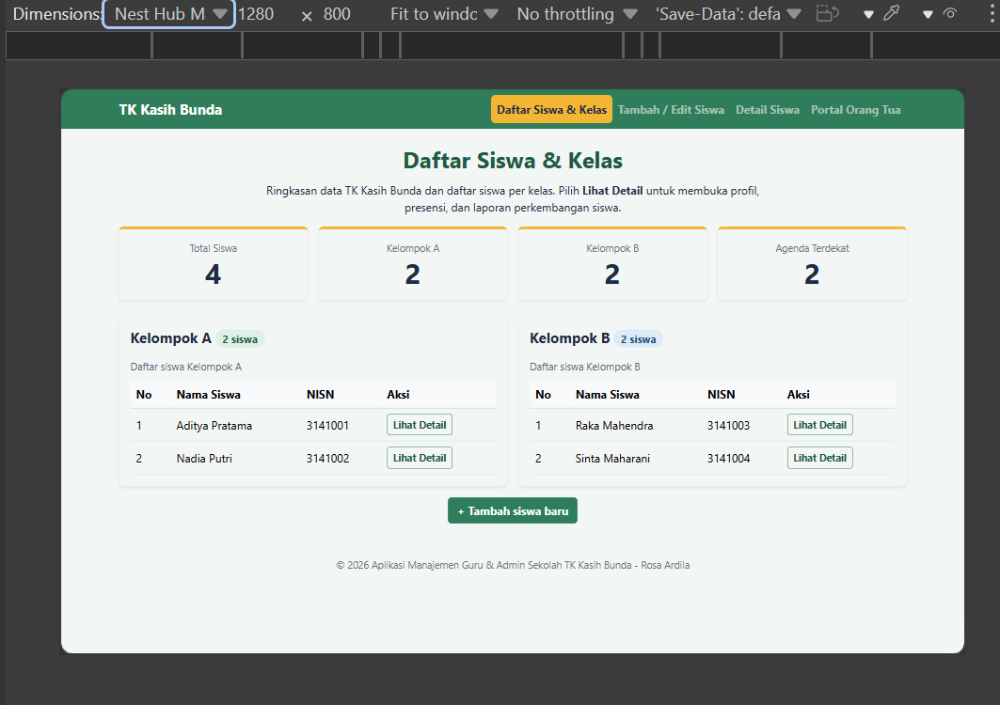
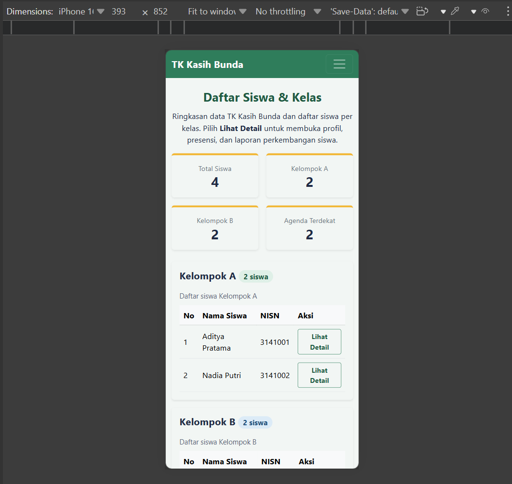

# Aplikasi Manajemen Guru & Admin TK Kasih Bunda

Aplikasi web untuk mengelola data siswa, presensi, dan laporan perkembangan anak di TK Kasih Bunda, dengan Portal Orang Tua (read-only) yang login memakai NISN anak.

**Tugas 4 (Bootstrap):** melanjutkan HTML (Minggu 2) dan CSS native (Minggu 3). Seluruh halaman dikonversi ke **Bootstrap 5.3 (CDN)**, sedangkan tema warna hijau–kuning–navy dari `style.css` dipertahankan lewat kustomisasi variabel Bootstrap. Belum terhubung ke backend/database.

## Daftar Halaman
| File | Keterangan | Syarat tugas |
|---|---|---|
| `index.html` | Dashboard ringkasan (grid kartu statistik) + daftar siswa per kelas | Dashboard grid & tabel/daftar |
| `form.html` | Form tambah / edit data siswa | Form |
| `detail.html` | Detail siswa (profil, presensi, laporan perkembangan, dokumentasi) | — |
| `login-guru.html` | Login guru dan admin | Form |
| `login-ortu.html` | Login orang tua | Form |
| `portal-ortu.html` | Portal orang tua (read-only) | — |
| `style.css` | Tema warna + komponen tambahan di atas Bootstrap | — |

## Penerapan Bootstrap
- **Grid:** `container` / `row` / `col-*` (mis. kartu statistik `col-6 col-lg-3`, dua tabel kelas `col-12 col-lg-6`, form `col-12 col-md-*`, profil + foto).
- **Navigasi responsif:** `navbar navbar-expand-lg` dengan tombol hamburger (collapse) di layar kecil.
- **Komponen:** card, table + `table-responsive`, badge, form control/select, button.

## Alasan Memilih Bootstrap
1. Aplikasi ini berpusat pada tabel data, form, dan dashboard. Bootstrap sudah menyediakan komponen siap pakai untuk itu, jadi pengembangan halaman admin lebih cepat dan konsisten.
2. Grid `container–row–col` memudahkan layout responsif, penting karena guru/admin sering membuka dari HP maupun laptop, dan orang tua kebanyakan dari HP.
3. Cukup lewat CDN tanpa build tool, sehingga tidak menambah kompleksitas di awal proyek fullstack.
4. Tema khas sekolah (hijau–kuning) tetap bisa dipertahankan lewat CSS variables dan class kustom di `style.css`.

## Screenshot
Disimpan di `docs/screenshots/`.

### Desktop

### Mobile

## Pembuat
Rosa Ardila — S1 Rekayasa Perangkat Lunak, Universitas Telkom
